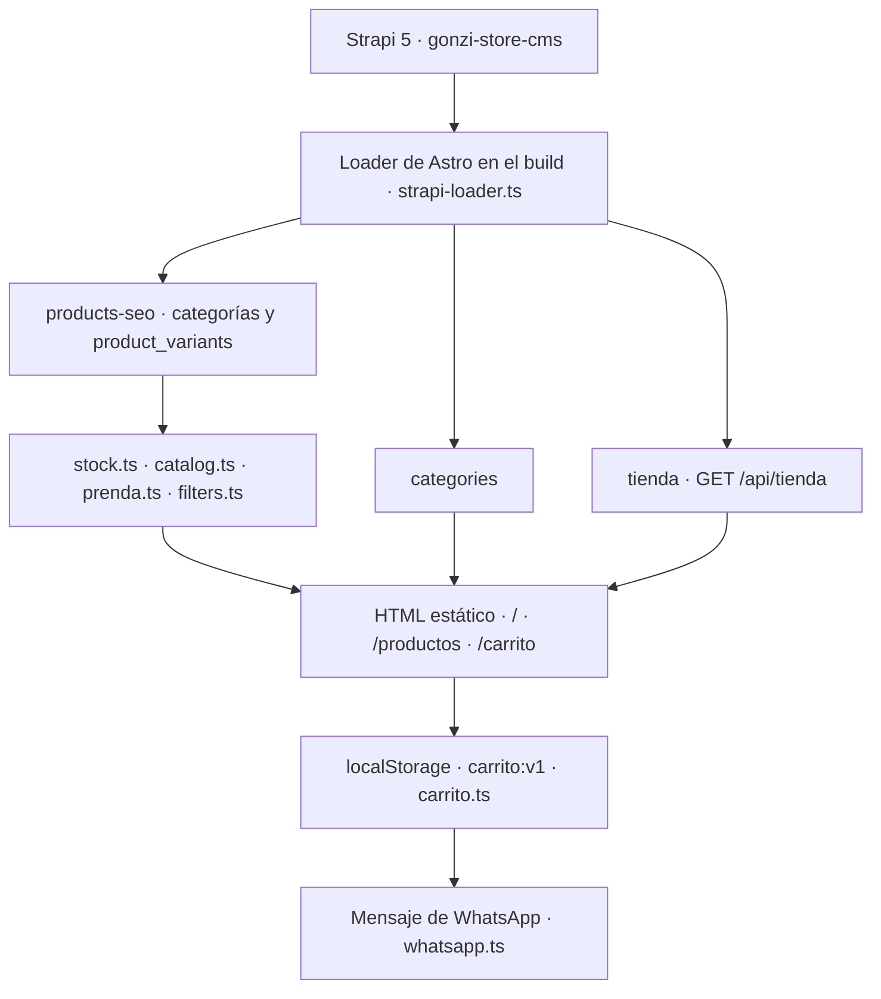

# Cómo llegan los datos a la tienda

El sitio es estático. En el build, Astro lee el CMS y deja las páginas en HTML. El visitante no llama a Strapi.

El CMS es otro repo: [gonzi-store-cms](https://github.com/gaCorvalan/gonzi-store-cms) (Strapi 5). Esta tienda solo lo lee.

## Qué baja el build

`src/lib/strapi-loader.ts` pide, al hacer `npm run dev` o `npm run build`:

- `GET /api/products`, con `image`, `categories`, `product_variants` y `product_sets`. La clave de las variantes es `product_variants`.
- `GET /api/categories`, con `image`, `products`, `subcategories`, `category` y `product_sets`.
- `GET /api/tienda`, el tipo único: nombre, whatsapp, texto de envío y moneda.

Strapi manda las colecciones de a 25. El loader sigue de página en página hasta bajar todo. Las fotos con ruta relativa quedan con la URL del CMS.

Esas respuestas alimentan las colecciones de `src/content.config.ts`:

- `products-seo`
- `categories`
- `tienda`

Con eso se arman `/`, `/pagina/2` (y las que sigan), `/productos/[slug]` y `/carrito`. Si la Tienda no está publicada, el build sigue y el nombre queda en «Tienda». Un whatsapp vacío no corta el build.

## Dónde vive cada regla

El HTML ya trae el catálogo. Estas funciones no vuelven a pedir nada:

| Archivo | Qué decide |
| --- | --- |
| `src/lib/stock.ts` | Stock total, estado (pieza única, última unidad, sin stock, disponible), precio de la variante y el peso en pesos. |
| `src/lib/catalog.ts` | Etiqueta y precio de la tarjeta, y el corte de a 24 prendas. |
| `src/lib/prenda.ts` | Talle, color, cantidad y precio de la ficha. |
| `src/lib/filters.ts` | Búsqueda, filtros (categoría, talle, color) y orden. La elección queda en la URL. |
| `src/lib/carrito.ts` | Carrito en `localStorage`, clave `carrito:v1`. El tope de cada línea es el stock de la variante al agregarla. |
| `src/lib/whatsapp.ts` | Texto del pedido (subtotal por línea) y el link `wa.me`. No vacía el carrito. |

El número de WhatsApp no está en este repo. Se carga en el CMS, en el tipo único Tienda.

## Para ver un cambio del CMS

Stock, precios, fotos y el número de WhatsApp quedan escritos en el HTML del build. Un cambio en el CMS se ve recién después de volver a armar el sitio. Todavía no hay un deploy definido.

